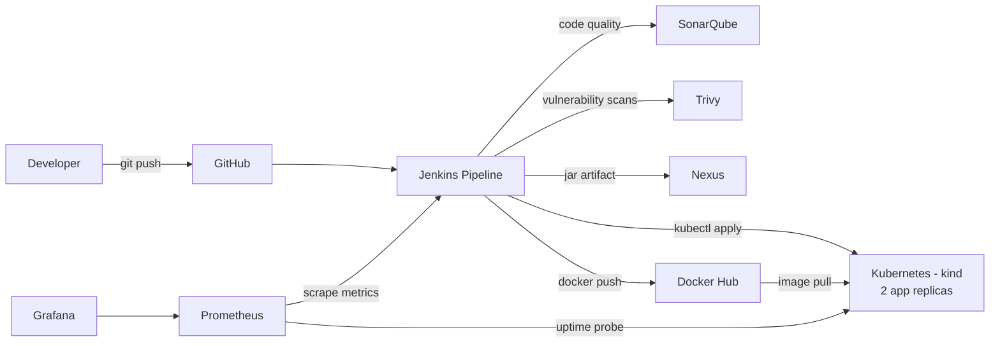

# 🚀 End-to-End CI/CD Pipeline for a Spring Boot Blogging App

**git push → live on Kubernetes in ~3 minutes, fully automated, running locally for $0.**

This project takes a Spring Boot blogging application from source code to a monitored Kubernetes deployment through a **16-stage Jenkins pipeline**. It covers build, test, code-quality analysis, security scanning, artifact management, containerization, deployment and monitoring.

The whole toolchain runs locally with **Docker Compose** and a **kind** Kubernetes cluster, so no cloud account or bill is needed.


---

## 📌 Table of Contents

- [Architecture](#-architecture)
- [Pipeline Stages](#-pipeline-stages)
- [Tech Stack](#-tech-stack)
- [Project Structure](#-project-structure)
- [Prerequisites](#-prerequisites)
- [Getting Started](#-getting-started)
- [Screenshots](#-screenshots)
- [Problems Solved](#-problems-solved)
- [Stop and Clean Up](#-stop-and-clean-up)
- [Credits](#-credits)

---

## 🏗 Architecture



Everything except GitHub and Docker Hub runs as containers on one machine:

| Service | Purpose | Local URL |
| --- | --- | --- |
| Jenkins | CI/CD orchestration | http://localhost:8080 |
| SonarQube | Static code analysis + Quality Gate | http://localhost:9000 |
| Nexus | Maven artifact repository | http://localhost:8081 |
| Prometheus | Metrics collection | http://localhost:9090 |
| Grafana | Dashboards | http://localhost:3000 |
| Blogging app | Deployed on Kubernetes | http://localhost:8090 (via port-forward) |

---

## 🔄 Pipeline Stages

| # | Stage | What it does |
| --- | --- | --- |
| 1 | Git Checkout | Pulls the latest code from GitHub |
| 2 | Compile | `mvn compile` |
| 3 | Test | Runs unit tests, with JaCoCo coverage |
| 4 | File System Scan | Trivy scans source and dependencies for vulnerabilities |
| 5 | SonarQube Analysis | Static analysis for bugs, code smells and duplication |
| 6 | Quality Gate | Waits for SonarQube's verdict via webhook |
| 7 | Build | Packages the app as a JAR |
| 8 | Publish to Nexus | Uploads the versioned artifact to Nexus |
| 9 | Build & Tag Docker Image | Builds a multi-architecture-friendly image |
| 10 | Docker Image Scan | Trivy scans the container image |
| 11 | Push Docker Image | Pushes the image to Docker Hub |
| 12 | Deploy to Kubernetes | `kubectl apply` with a least-privilege service account |
| 13 | Verify the Deployment | Checks pods and services in the `webapps` namespace |
| — | Post Actions | Sends an HTML build-status email (Gmail SMTP) |

---

## 🛠 Tech Stack

| Category | Tools |
| --- | --- |
| Application | Java 17, Spring Boot 3, Spring Security, Thymeleaf, H2, Maven |
| Source Control | Git, GitHub |
| CI/CD | Jenkins (declarative pipeline) |
| Code Quality | SonarQube, JaCoCo |
| Security (DevSecOps) | Trivy (filesystem + image scanning) |
| Artifact Management | Nexus Repository |
| Containers | Docker, Docker Compose, Docker Hub |
| Orchestration | Kubernetes (kind), RBAC |
| Monitoring | Prometheus, Grafana, Node Exporter, Blackbox Exporter |
| Infrastructure as Code (optional cloud path) | Terraform for AWS EKS (`EKS_Terraform/`) |

---

## 📁 Project Structure

```
.
├── src/                      # Spring Boot application source
├── pom.xml                   # Maven build + Nexus distribution settings
├── Dockerfile                # Container image (eclipse-temurin:17-jre)
├── Jenkinsfile               # 16-stage CI/CD pipeline (local kind cluster)
├── Jenkinsfile.aws           # Same pipeline targeting AWS EKS
├── deployment-service.yml    # Kubernetes Deployment (2 replicas) + Service
├── EKS_Terraform/            # Optional: Terraform for an AWS EKS cluster
├── local-setup/
│   ├── docker-compose.yml    # Jenkins, SonarQube, Nexus, Prometheus, Grafana, exporters
│   ├── Dockerfile.jenkins    # Jenkins + JDK 17, Maven, Docker CLI, Trivy, kubectl
│   └── prometheus.yml        # Scrape config (Jenkins, Node Exporter, Blackbox)
└── docs/screenshots/         # Images used in this README
```

---

## ✅ Prerequisites

- macOS (Intel or Apple Silicon) or Linux with **16 GB RAM** recommended
- [Docker Desktop](https://www.docker.com/products/docker-desktop/), with at least 8 GB memory allocated
- Java 17, `kind`, `kubectl` and `git`
- A GitHub account and a Docker Hub account

```bash
brew install openjdk@17 kind kubectl git
brew install --cask docker
```

---

## 🚀 Getting Started

### 1. Clone and run the app locally

```bash
git clone https://github.com/Faiz-Hussain650/FullStack-Blogging-App.git
cd FullStack-Blogging-App
./mvnw test
./mvnw spring-boot:run      # open http://localhost:8080
```

### 2. Create the Kubernetes cluster

```bash
kind create cluster
kubectl create ns webapps
```

Then create the `jenkins` service account, a namespace-scoped Role and RoleBinding, and a token secret, so Jenkins can deploy only to `webapps`. Print the token for Jenkins:

```bash
kubectl get secret mysecretname -n webapps -o jsonpath='{.data.token}' | base64 -d; echo
```

Create the Docker Hub pull secret:

```bash
kubectl create secret docker-registry regcred -n webapps \
  --docker-server=https://index.docker.io/v1/ \
  --docker-username=<your-dockerhub-user> \
  --docker-password=<your-dockerhub-token> \
  --docker-email=<your-email>
```

### 3. Start the DevOps toolchain

```bash
cd local-setup
docker compose up -d --build
docker compose ps
```

> Create the kind cluster **first**. Jenkins joins the `kind` Docker network so it can reach `https://kind-control-plane:6443`.

### 4. Configure the tools

| Tool | Setting |
| --- | --- |
| SonarQube | Generate a token; add webhook `http://jenkins:8080/sonarqube-webhook/` |
| Nexus | Set `maven-releases` deployment policy to **Allow redeploy** |
| Jenkins → Tools | `jdk17` = `/opt/jdk17`, `maven3` = `/opt/maven`, `docker` = `/usr/local`, `sonar-scanner` = auto-install |
| Jenkins → Credentials | `git-cred`, `sonar-token`, `docker-cred`, `k8-cred`, `mail-cred` |
| Jenkins → Managed files | Global Maven settings `global-settings` with Nexus credentials |
| Jenkins → System | SonarQube server `sonar` at `http://sonarqube:9000` |

> Inside Docker, containers reach each other **by service name** (`sonarqube`, `nexus`, `jenkins`), not `localhost`.

### 5. Run the pipeline

Create a **Pipeline** job → *Pipeline script from SCM* → this repo, branch `*/main`, script path `Jenkinsfile` → **Build Now**.

### 6. Open the deployed app

```bash
kubectl get pods -n webapps
kubectl port-forward --address 0.0.0.0 svc/bloggingapp-ssvc -n webapps 8090:80
```

Visit **http://localhost:8090**.

### 7. Monitoring

In Grafana, add the Prometheus data source `http://prometheus:9090`, then import dashboards **1860** (Node Exporter Full) and **7587** (Blackbox Exporter).

---

## 📸 Screenshots

| Jenkins pipeline (all stages green) | App running on Kubernetes |
| --- | --- |
|  |  |

| SonarQube Quality Gate | Grafana monitoring |
| --- | --- |
|  |  |

**Results:** SonarQube Quality Gate **Passed** with **0 vulnerabilities**. The pipeline flagged 4 bugs, which are tracked as next improvements.

---

## 🐛 Problems Solved

| Problem | Root cause | Fix |
| --- | --- | --- |
| `docker build` failed on Apple Silicon | `eclipse-temurin:17-jdk-alpine` has no arm64 build | Switched to multi-arch `eclipse-temurin:17-jre` |
| `./mvnw` could not start | `.mvn/wrapper/maven-wrapper.properties` missing from the repo | Restored the Maven wrapper config |
| Publish to Nexus: `401 Unauthorized` | Malformed `settings.xml` (mismatched XML tags, placeholder password) | Corrected the Jenkins managed settings file |
| Jenkins could not reach SonarQube/Nexus | `localhost` inside a container points to itself | Used Docker network service names |
| Jenkinsfile failed to load | Unclosed `stages` block, wrong manifest filename, region typo | Fixed the pipeline syntax |

---

## 🧹 Stop and Clean Up

```bash
# Pause everything (keeps data)
docker compose stop && docker stop kind-control-plane

# Resume later
docker start kind-control-plane && docker compose start

# Remove everything
docker compose down -v && kind delete cluster
```

---

## 👤 Author

**Faiz Hussain**
GitHub: [@Faiz-Hussain650](https://github.com/Faiz-Hussain650)

⭐ If you found this useful, consider starring the repo!
